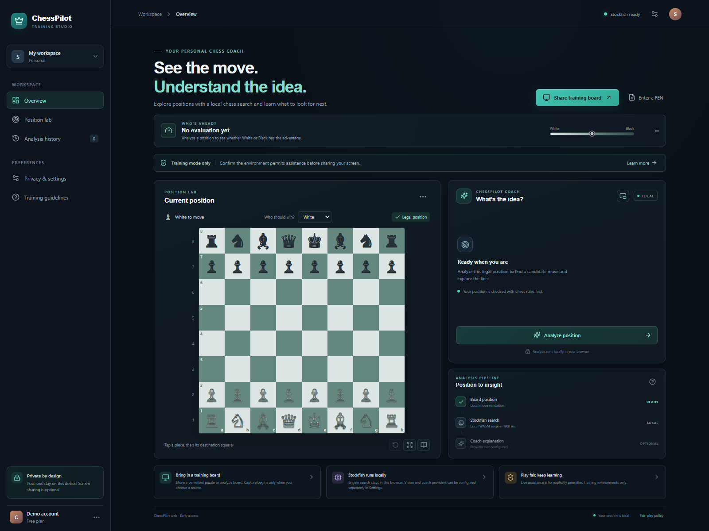
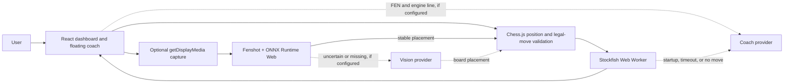

# ChessPilot

<p align="center">
  
</p>

<p align="center"><strong>A private, browser-based chess training and analysis workspace.</strong></p>

<p align="center">
  <a href="https://santhoshkumarsampathkumar.github.io/chesspilot/">Live demo</a> ·
  <a href="docs/ARCHITECTURE.md">Architecture</a> ·
  <a href="CONTRIBUTING.md">Contributing</a> ·
  <a href="SECURITY.md">Security</a>
</p>

ChessPilot combines a legal chessboard, local Stockfish analysis, optional screen-based board recognition, and an optional AI coach in one client-side application. Screen frames and engine searches stay in the browser unless you explicitly configure an AI provider and its fallback is used.

ChessPilot is an independent project. Its optional AI vision and coaching features can use models through the [Top Billing API gateway](https://topbilling.in/), which exposes an OpenAI-compatible chat endpoint. Top Billing is a service ChessPilot can connect to; it did not create or publish this repository.

## Product capabilities

- Edit a position interactively or load a FEN. Chess.js validates position state and legal moves.
- Analyze with Stockfish 19 Lite in a Web Worker using WebAssembly. The UI can show up to five candidate lines and their evaluations.
- Share a permitted training screen. Fenshot and ONNX Runtime Web attempt local board recognition; stable board observations update the position and start analysis automatically.
- Detect board orientation and square colors from the shared board image.
- Configure separate Top Billing/OpenAI-compatible vision and coaching providers. Vision is an opt-in fallback when local recognition cannot produce a sufficiently reliable position. The coach can explain an engine line or suggest a legal candidate if Stockfish fails.
- Open a floating coach panel in browsers that support Document Picture-in-Picture.
- Choose which side should win to guide move recommendations. The choice affects candidate selection; it does not prove that a position is won or force an outcome.

ChessPilot is for puzzles, bots, and analysis positions where assistance is allowed. Follow the rules of the environment you use.

## Quick start

To try ChessPilot without cloning or installing anything, open the [hosted demo](https://santhoshkumarsampathkumar.github.io/chesspilot/).

To run from a clone, install Git, Node.js 20+, and npm. Paste the command for your shell. It clones the repo, installs JavaScript dependencies once, and starts the app:

PowerShell:

```powershell
git clone https://github.com/SanthoshkumarSampathkumar/chesspilot.git; if ($?) { Set-Location chesspilot; npm ci; if ($?) { npm run dev } }
```

Bash / macOS / Linux:

```sh
git clone https://github.com/SanthoshkumarSampathkumar/chesspilot.git && cd chesspilot && npm ci && npm run dev
```

Open the local URL printed by Vite. Screen capture requires a secure context (`localhost` or HTTPS) and explicit browser source selection. The Stockfish engine, matching WASM file, and chess recognition model are included in this repository; no separate model or engine download is needed. `npm ci` does need network access on first setup to fetch pinned JavaScript dependencies. After installation, the core board, recognition, and Stockfish workflow does not call an AI service.

### Optional Top Billing AI models

AI is optional. To enable it, open **Privacy & settings** in ChessPilot and enter a Top Billing API key and model ID in the **AI coach provider** settings. The endpoint is prefilled as `https://api.topbilling.in/v1/chat/completions`. Save the settings, then analyze a position. The coach can explain Stockfish lines and provide a legal-move fallback if Stockfish fails.

For screenshot-based AI recognition, configure the separate **Vision model fallback** with the same gateway endpoint, an image-capable model ID, and your key. This is only called when local recognition misses or returns an uncertain position. Model IDs and capabilities can change; choose an available model in [Top Billing Models](https://topbilling.in/models) and see the [Top Billing quickstart](https://topbilling.in/docs) for API keys.

Requests go directly from your browser to the configured gateway. ChessPilot saves provider settings encrypted in this browser profile, but a browser application cannot keep an entered API key secret from code running on the same origin. Do not enter a production key on a shared or untrusted device. A public multi-user deployment should use a backend proxy with server-side secret storage.

### Maintainer checks

```sh
npm test
npm run build
npm run preview
```

The production bundle expects the paired engine files under `/engine/` and the recognition model under `/models/`. Do not separate the Stockfish JavaScript worker from its matching WASM file.

## Runtime at a glance



The detailed component, sequence, privacy, and deployment notes are in [docs/ARCHITECTURE.md](docs/ARCHITECTURE.md).

## Privacy model

- Screen capture begins only after the user selects a source. Frames are sampled and analyzed in the active browser session.
- Local recognition, board-state checks, and Stockfish analysis run client-side.
- A configured vision provider receives a sampled frame only when vision fallback runs. A configured coach provider receives position data when a coach explanation or engine-failure fallback runs.
- Provider settings are encrypted with Web Crypto AES-GCM and saved to IndexedDB for this browser profile. This protects stored bytes at rest from casual inspection; it is not a server-side secrets vault and does not protect against malicious same-origin JavaScript or an already compromised browser profile.
- Never commit provider keys, `.env` files, personal captures, or private game data.

## Repository map

| Path | Responsibility |
| --- | --- |
| `src/App.tsx` | Dashboard, state coordination, screen capture, recognition loop, provider calls, floating coach, and Stockfish worker lifecycle |
| `src/analysis.ts` | UCI info parsing, score normalization to White's perspective, and legal UCI-to-SAN variation conversion |
| `src/analysis.test.ts` | Unit coverage for engine protocol parsing and chess-line conversion |
| `src/style.css` | Responsive dashboard, board, capture, and floating coach styles |
| `public/engine/` | Stockfish worker runtime, matching WebAssembly binary, and engine license |
| `public/models/` | ONNX chessboard recognition model and model license |
| `.github/workflows/` | Pull request CI and GitHub Pages deployment |
| `docs/ARCHITECTURE.md` | System design, request flows, constraints, and operational details |

## Build and release

GitHub Actions runs `npm test` and `npm run build` on pushes and pull requests to `main`. A separate workflow builds with the `/chesspilot/` base path and deploys the static `dist/` directory to GitHub Pages.

For a root-mounted static host, use `npm run build`. For GitHub Pages, use `npm run build:pages`. The static host must serve the files in `dist/`; it does not need a backend service.

## Licensing

ChessPilot is distributed under [GPL-3.0-only](LICENSE). Third-party engine and model notices, including upstream source links, are listed in [THIRD-PARTY-NOTICES.md](THIRD-PARTY-NOTICES.md). Review those terms before redistributing a modified bundle.
