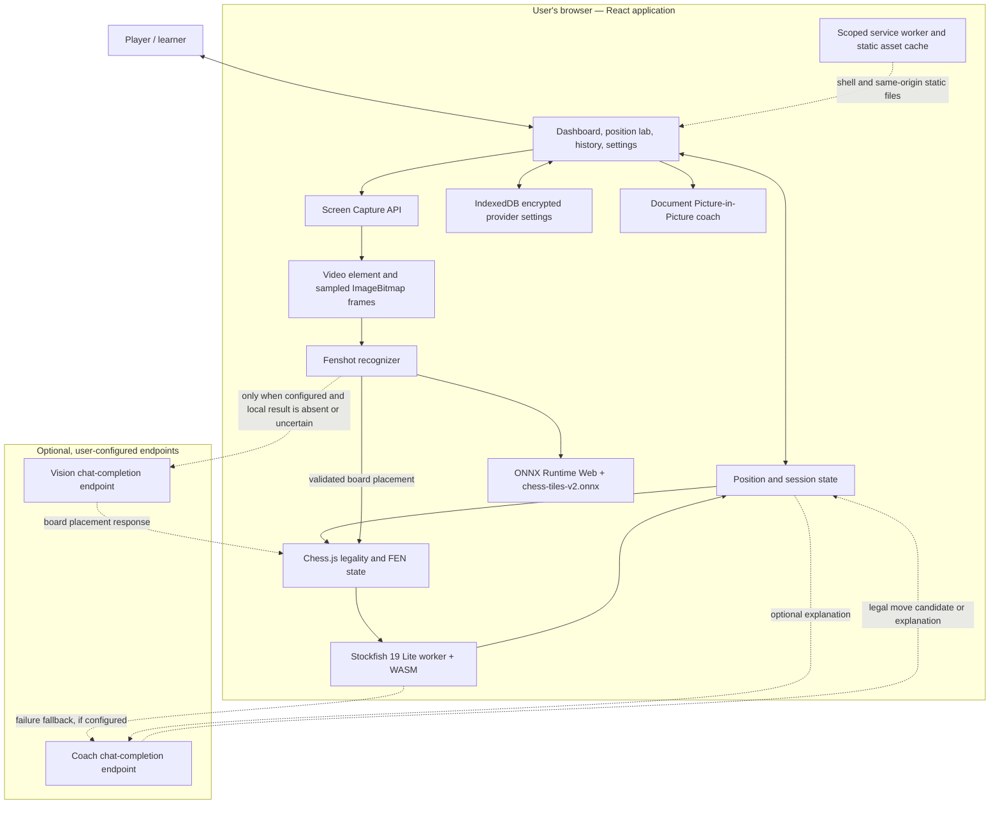
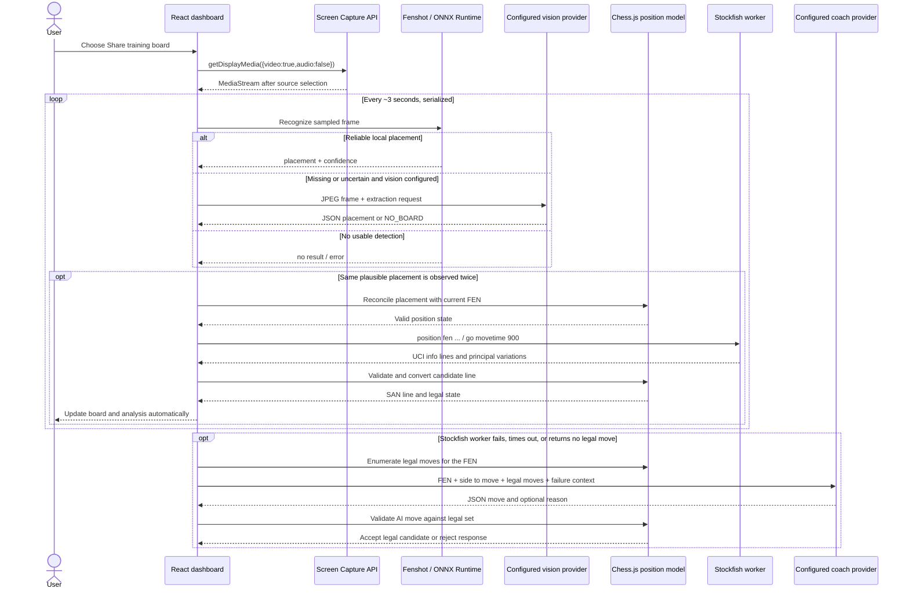

# ChessPilot architecture

This document describes the application as implemented in the repository. ChessPilot is an independent static single-page application: there is no ChessPilot API server, database service, or server-side analysis process. The browser owns the application state and orchestrates local computation and optional provider requests. ChessPilot can use the [Top Billing API gateway](https://topbilling.in/) for optional model calls; Top Billing is a gateway service integration, not the creator or publisher of this project.

## System context

The dotted edges cross the browser boundary and represent optional outbound provider requests. The vision endpoint receives a JPEG image derived from a sampled frame. The coach endpoint receives a FEN, legal move candidates, and/or an engine line depending on the request. No provider call is made without complete settings for that provider.

## Component responsibilities

| Component | Implementation | Contract and constraints |
| --- | --- | --- |
| Presentation and coordination | `src/App.tsx`, React 18 | Owns UI state and coordinates worker, capture, recognition, and provider lifecycles. This is currently a single large application module rather than a set of independent packages. |
| Position model | `chess.js` in `src/App.tsx` | Canonical position is a validated FEN. Moves are checked against legal moves before applying. Recognized piece placement lacks turn, castling, and en-passant metadata; the app preserves existing game metadata when a matching position is reachable within two plies, otherwise it constructs a placement-based FEN. |
| Engine adapter | `src/App.tsx`, `src/analysis.ts` | Creates a classic Web Worker from the public Stockfish JavaScript runtime, points it to the paired WASM asset, speaks UCI, requests MultiPV 5, and limits normal searches to 900 ms. A 15-second watchdog handles stalled searches. |
| UCI normalization | `src/analysis.ts` | Parses `info` lines, converts score to White's perspective, and converts UCI principal variations to SAN while stopping at the first illegal or malformed move. |
| Capture adapter | `navigator.mediaDevices.getDisplayMedia` in `src/App.tsx` | Explicit user selection starts a `MediaStream`. Track `ended`, `mute`, `unmute`, and stream `inactive` events keep UI status synchronized. Capture ends when the browser or selected source ends its track. |
| Recognition pipeline | `@scoriiu/fenshot`, ONNX Runtime Web | Uses the local ONNX model from `public/models/`. Frames are sampled on a three-second interval; recognition work is serialized, local detections are confidence/plausibility checked, and the same placement must be stable across at least two observations before synchronizing. |
| Board presentation | React state and CSS | Orientation is resolved from the detected placement. Square colors are sampled from the detected board area and applied to the local board. |
| Vision fallback | OpenAI-compatible chat completion in `src/App.tsx` | Defaults to Top Billing's `https://api.topbilling.in/v1/chat/completions` endpoint. Only runs when a vision endpoint, image-capable model ID, and key are configured and local recognition does not produce a reliable result. Provider output is parsed as piece placement and checked for valid rank structure and exactly one king per side; chess legality is separately checked by Chess.js. |
| Coach and move fallback | OpenAI-compatible chat completion in `src/App.tsx` | Defaults to Top Billing's `https://api.topbilling.in/v1/chat/completions` endpoint. Explains the Stockfish candidate when requested. If Stockfish is unavailable, times out, or returns no legal move, the fallback sends the position and legal moves; the returned move must match a legal SAN or UCI move before it is accepted. AI output is not engine-verified. |
| Provider settings | Web Crypto + IndexedDB in `src/App.tsx` | Uses a non-extractable AES-GCM key stored in IndexedDB, random 96-bit IV per saved provider record, and encrypted provider settings. Decryption occurs in the app when settings load. This is local browser storage, not protection against same-origin script execution. |
| Floating coach | Document Picture-in-Picture API | Opens a separate same-origin document window where supported by the browser. Analysis state remains in the app; the floating surface follows the current position and analysis. |
| Static delivery | Vite + GitHub Pages Actions | Builds static `dist/` artifacts. No runtime API keys or server-side environment variables are required to serve the app. Optional provider credentials are entered by the user in browser settings. |
| Offline shell | `public/sw.js`, web app manifest | The service worker is scoped to the deployment base path, precaches the app shell, uses network-first navigation with an offline shell fallback, and cache-first for same-origin engine, model, and bundled app assets. It does not intercept cross-origin provider traffic. |

## Screen-to-analysis sequence

The recognition loop deliberately requires repeated stable observations before replacing the active position. This filters transient frames but adds a short update delay. Position recognition returns piece placement rather than the full game state, so special-move metadata cannot always be reconstructed from a screenshot alone.

## Analysis lifecycle

1. The position lab, FEN loader, or recognition synchronizer supplies a FEN.
2. Chess.js parses the FEN. Invalid positions fail before engine search.
3. A `positionId` marks the newest requested search. Older results are ignored after the active position changes.
4. The worker receives `position fen ...` and `go movetime 900`. The app collects the deepest UCI info per MultiPV index.
5. Principal variations are replayed on cloned Chess.js positions to produce SAN. Candidate scores are normalized to White's perspective so White/Black UI labels do not depend on side to move.
6. After `bestmove`, the app publishes the principal variation, alternatives, score, search depth, and timing. On worker error, timeout, or missing legal move, optional AI fallback runs.

The Stockfish worker and WASM are public assets under `public/engine/`. The app sets the worker's WASM URL through the worker URL hash and adds cache-busting version parameters; a deployment must preserve this asset pairing and the `/engine/` path.

## Privacy and trust boundaries

### Local by default

Screen capture, frame sampling, local ONNX inference, Chess.js validation, board rendering, and Stockfish search execute in the browser. The repository has no capture upload endpoint or chess data backend. GitHub Pages only serves static build output.

### Provider opt-in

Vision and coach providers are configured independently. Requests go directly from the browser to the endpoint the user entered:

- **Vision:** one JPEG image plus the board extraction prompt when the local result is absent or unreliable.
- **Coach explanation:** the current FEN, engine candidate, principal variation, and evaluation.
- **AI move fallback:** the current FEN, side to move, legal moves, and Stockfish failure context.

The user-configured provider is responsible for its own request handling, logging, retention, and privacy controls. The default Top Billing endpoint is OpenAI Chat Completions compatible; users provide their own API key and model ID. The gateway's model catalog lists current IDs and capabilities, including which models accept images. See [Top Billing docs](https://topbilling.in/docs) and [model catalog](https://topbilling.in/models). Browser CORS and provider compatibility also affect whether requests succeed.

### Credential storage

Saved provider settings are encrypted with AES-GCM in IndexedDB using a non-extractable Web Crypto key stored in the same origin's IndexedDB. This reduces exposure from opening the stored record directly. Since application code on the same origin can retrieve and use the key, it is not a server-side vault and does not mitigate XSS, malicious extensions, malware, or a compromised browser profile. The key is sent directly from the browser to the configured gateway. Do not use a production key on shared or untrusted devices. Top Billing's [security guidance](https://www.topbilling.in/docs/security) advises against embedding API keys in browser applications; a public multi-user deployment should broker calls through an authenticated backend with server-side secret storage.

## Deployment and browser requirements

- **Local development:** clone the repository, run `npm ci` once, then `npm run dev`; this downloads pinned JavaScript dependencies from npm. The Stockfish JavaScript/WASM pair and chess recognition model are checked into `public/`, so there is no separate engine or model-weight download. Vite serves the app at localhost and sets COOP/COEP headers for local cross-origin isolation scenarios.
- **Root-mounted static host:** `npm run build`; serve `dist/` at `/` over HTTPS.
- **GitHub Pages:** `npm run build:pages`; Vite sets the `/chesspilot/` project path. `.github/workflows/pages.yml` uploads `dist/` and deploys it with the Pages artifact flow.
- **Screen capture:** requires browser support for `getDisplayMedia`, a secure context, and explicit user source selection.
- **Install and offline:** the web app manifest enables installation where supported. On first load, the service worker caches the shell, main application bundles, Stockfish, and board model. The larger ONNX inference WASM is cached when recognition is first used. Visit online and allow each required feature to load before relying on it offline. AI provider requests remain online-only. Browser storage eviction can remove cached files.
- **Floating panel:** requires Document Picture-in-Picture support; other browsers keep the regular dashboard coach.
- **WASM assets:** the engine worker must be same-origin reachable at the configured base path. The ONNX Runtime Web WASM files are emitted from the installed package during the Vite build.

GitHub Pages serves these static files without custom response headers. If a browser/model combination requires cross-origin isolation to use threaded WASM, deploy on a host that can set the appropriate COOP/COEP headers or use a single-threaded inference runtime. Local development and `vite preview` already set those headers in Vite configuration.

## Known constraints

- `src/App.tsx` currently contains most application coordination. Extracting engine, capture, provider, and vault adapters into modules is a reasonable next refactor, but the current implementation has one owner for these lifecycles.
- Board recognition quality depends on board size, crop, contrast, piece set, animation, and the model's training distribution. The local pass can miss a board; vision fallback is opt-in and adds network/privacy trade-offs.
- A screenshot gives piece placement, not a full FEN. Turn, castling rights, en-passant square, and move counters may be inferred from the previous position only for a short move horizon; otherwise defaults are used.
- The configured AI coach can return a legal move that is strategically weak. Legality validation does not establish chess strength or match Stockfish's analysis.
- Browser suspension, source permission revocation, display-source termination, and device/browser resource limits can interrupt capture or worker activity.
- GitHub Actions may emit upstream action-runtime deprecation warnings even when a deployment succeeds; review workflow annotations after runner or action updates.

## Change checklist

When changing the runtime, update the related contract and diagrams here. In particular, keep these aligned:

- asset filenames and Vite base path (`vite.config.ts`, README, Pages workflow)
- service worker cache version and offline precache assumptions (`public/sw.js`)
- Stockfish JS/WASM version pairing and notices
- recognition model URL and its license notice
- provider request payloads and the data leaving the browser
- CI commands and browser capability requirements
